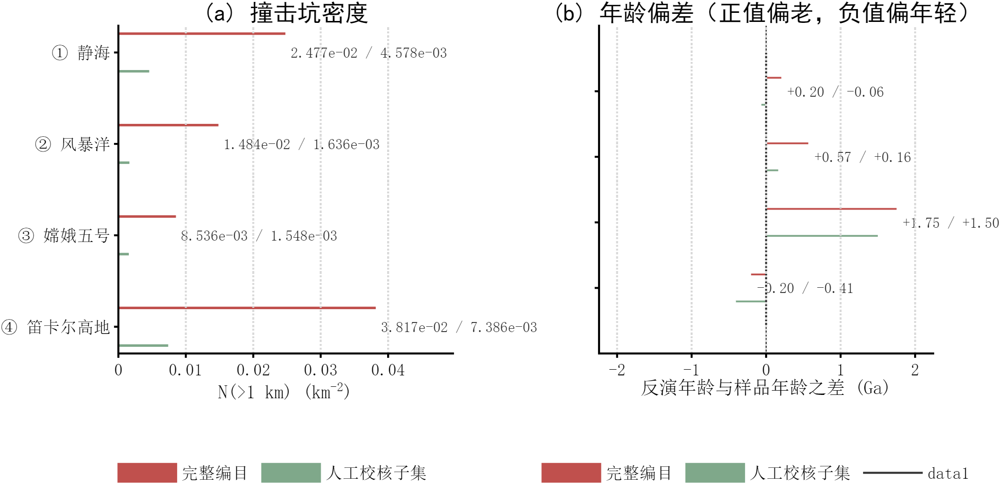

# 🌕 Lunar Crater Chronology
### 基于 MATLAB 的月球撞击坑统计定年与月海年龄估算
**Lunar surface ages from crater size–frequency distributions**

`MATLAB R2025a` · `CSFD` · `Neukum chronology` · `Monte Carlo` · `MIT License`

本项目围绕一个核心问题：**如何用撞击坑统计信息推断月球表面年龄，以及如何判断这个年龄能不能信？**

代码从全月撞击坑编目出发，依次完成：读编目 → 圈研究区 → 构建累积尺寸—频率分布（CSFD）→ 用 Neukum 生产函数/年代函数反演年龄 → 蒙特卡洛误差传播 → 参数敏感性 → 出图。全流程 26 个 MATLAB 文件、约 2300 行，在本机跑完一次 **约 4 分钟**。

本 README 分三部分写，而不是只报四个年龄数字：

| | 内容 | 回答的问题 |
| --- | --- | --- |
| **一、方法验证** | 用已知年龄的合成编目检验反演链 | 代码算得对不对？ |
| **二、真实月球区域分析** | 四个研究区的模式年龄与误差 | 真实编目算出来是多少？ |
| **三、方法适用边界** | 年轻单元、编目来源、区域半径、拟合区间、次级坑 | 什么情况下这些数字不能用？ |

> **一句话结论**：方法链在合成数据上把年龄恢复到平均偏差 0.029 Ga；用真实编目得到的四个模式年龄，对 ≥3 Ga 的月海比样品年龄偏老 0.2–0.6 Ga，对 2.03 Ga 的嫦娥五号年轻玄武岩偏老 **1.75 Ga**。所以本项目把「年龄计算」和「结果可信度」分开报告——后者才是这个项目真正想讨论的东西。

---

## 一、方法验证：先把算法钉在已知答案上

### 1.1 合成数据回收试验

构造**已知年龄**的合成撞击坑编目（CSFD 严格由 Neukum 模型生成），再走完全相同的反演流程，看能不能把年龄找回来。生产配置：统计面积 70,000 km²、直径 1–20 km、每个年龄 200 次独立实现、随机种子 20260922。

| 设定年龄 T_true (Ga) | 反演均值 T_fit (Ga) | 1σ 离散度 (Ga) | 偏差 (Ga) |
| ---: | ---: | ---: | ---: |
| 0.50 | 0.539 | 0.139 | **+0.039** |
| 1.00 | 1.046 | 0.201 | **+0.046** |
| 2.00 | 2.024 | 0.268 | **+0.024** |
| 3.00 | 2.967 | 0.206 | **−0.033** |
| 3.70 | 3.699 | 0.010 | **−0.001** |

**平均绝对偏差 0.029 Ga，最大 0.046 Ga，最大偏差不到 0.05 Ga。** 这是"算法链本身没有系统性错误"的独立证据：编目换成完全已知的数据，反演仍然回到设定值附近。


### 1.2 这个 0.05 Ga 有配置依赖，不要把它当常数

同一套代码，把小配置（统计面积 31,407 km²、每年龄 60 次实现）拿来跑，2.0 Ga 处的偏差变成 **+0.106 Ga**；放大到 70,000 km²/200 次后回落到 +0.024 Ga。也就是说合成自检的偏差本身随"统计面积 × 实现次数"收敛——**引用"偏差在 0.05 Ga 以内"时必须同时说明配置**，否则换个区域半径就可能不成立。

### 1.3 复现

```matlab
run('code/test_synthetic.m')   % 合成数据全链路（不需要外部数据，约 1 分钟）
```

结果写入 `results/table4_selftest.csv` 与 `figures/_test/`。

---

## 二、真实月球区域分析

### 2.1 输入编目

| 项目 | 数值 |
| --- | --- |
| 编目 | LU1319373（Wang & Wu, 2021），直径 ≥ 1 km 的全月撞击坑编目 |
| 记录数 | **1,319,373** 条（解析耗时 15 s） |
| 直径范围 | 0.98 – 2,491.90 km，中位 1.56 km |
| 来源构成 | Source=0 自产 76.3%（1,006,919 条）；其余来自 Robbins (2019) 与 Head et al. (2010) |

获取方式、校验值、文件名与单位（Diameter/Depth 为**米**，代码里换算为 km）见 [data/README.md](data/README.md)。

### 2.2 四个研究区（统计半径 120 km，面积 45,221 km²，拟合区间 1–10 km，15 个拟合点）

| 研究区 | 坑数 | N(>1 km) (km⁻²) | 模式年龄 (Ga) | 蒙特卡洛 68% 区间 | 1σ | 参考年龄 (Ga) | 偏差 (Ga) |
| --- | ---: | ---: | ---: | --- | ---: | ---: | ---: |
| 静海（Apollo 11） | 1,120 | 2.477×10⁻² | **3.904** | [3.897, 3.910] | 0.006 | 3.70 | **+0.20** |
| 风暴洋（Apollo 12） | 672 | 1.484×10⁻² | **3.766** | [3.757, 3.775] | 0.009 | 3.20 | **+0.57** |
| 嫦娥五号着陆区 | 386 | 8.536×10⁻³ | **3.782** | [3.766, 3.796] | 0.015 | 2.03 | **+1.75** |
| 笛卡尔高地（对照区） | 1,729 | 3.817×10⁻² | **3.998** | [3.992, 4.003] | 0.006 | 4.20* | −0.20 |

\* 高地为高地表面，没有就地样品年龄，4.20 Ga 只是对照用的文献值，不参与反演。

参考年龄来源：静海、风暴洋为 Apollo 11/12 玄武岩样品区间（3.6–3.8 / 3.1–3.3 Ga）的代表值；嫦娥五号为 Che et al. (2021) 与 Li et al. (2021) 的玄武岩样品年龄 2.03 Ga。

### 2.3 三个需要读出来的细节

**① 统计误差远小于系统偏差。** 蒙特卡洛 1σ 只有 0.006–0.015 Ga，可它与样品年龄的差是 0.2–1.75 Ga。**泊松误差不是主要不确定性来源**，把 1σ 当作"年龄误差棒"会严重高估可信度。

**② N(>1 km) 单值不能决定年龄。** 嫦娥五号的 N(>1 km) 比风暴洋低 42%，两者模式年龄却几乎相同（3.78 vs 3.77 Ga）——因为反演用的是整条 CSFD 的形状，不是单一密度值。只报 N(>1 km) 或"坑越多越老"的直觉在这里会失效。

**③ 拟合优度差异很大。** `table2_ages.csv` 里的 `chi2_red` 是静海 3.02、风暴洋 0.06、嫦娥五号 6.95、高地 12.29。注意这个 χ² 的权重取的是累积计数 `w = n_u`，而残差在 log10 域，按泊松统计正确权重应含 (ln10)²≈5.30 因子，且累积点之间强相关，因此它只能当**相对量**用；若乘回 (ln10)²，四个区约为 16.0 / 0.31 / 36.9 / 65.2 —— 除风暴洋外，残差都远大于泊松噪声水平，说明模型 CSFD 的形状与观测存在系统失配（这也正是年龄偏老的同源问题）。这一项是本项目明确已知的局限。


---

## 三、方法适用边界

### 3.1 年轻月表：嫦娥五号偏老 1.75 Ga

嫦娥五号玄武岩的样品年龄是 2.03 Ga，而撞击坑统计给出 3.782 Ga，**偏老 1.75 Ga（约 85%）**。这不是调参能修掉的，四种配置给出的是同一个方向的偏差：

| 配置 | 模式年龄 (Ga) | 与样品差 (Ga) |
| --- | ---: | ---: |
| 完整编目，半径 120 km，拟合 1–10 km（默认） | 3.782 | +1.75 |
| 完整编目，半径 120 km，拟合 2–10 km | 3.922 | +1.89 |
| 完整编目，半径 80 km | 3.608 | +1.58 |
| 人工校核子集（70 坑），半径 120 km | 3.529 | +1.50 |

**机制**（三条同时成立，无法靠单点修正）：

1. **D ≈ 1 km 端的编目质量**：年轻单元上小坑以次级坑、退化坑、边缘破碎坑为主，低端 N 被抬高 → 年龄被抬高；而 NPF 在"极高密度"一侧本身也有饱和假定。
2. **地质单元混合**：120 km 圆形统计区必然跨越年轻玄武岩与更老的围岩/溅射物，混合表面按面积加权给出偏老的模式年龄。
3. **几何/直径下限**：把拟合下限从 1 km 提到 2 km，年龄立刻抬高 0.14 Ga，说明结果对"从哪个直径开始信编目"高度敏感，而这个下限本质是隐含假设。

**结论**：对 < 2 Ga 的年轻单元，本流程给出的是"在 D ≥ 1 km 编目 + NPF 下的模式年龄"，**不能当表面年龄使用**。要处理这类区域，需要 D ≥ 0.5 km 或更高分辨率编目，配合按单元边界（多边形）而不是圆形统计区。

### 3.2 编目来源：换成"人工校核"会改变什么

用编目中人工校核/坑缘拟合来源（Source = 1、2）构成的子集重跑，与完整编目对照：

| 研究区 | 坑数（完整 / 子集） | N 之比 | 完整编目年龄 | 子集年龄 | 偏差变化 |
| --- | ---: | ---: | ---: | ---: | --- |
| 静海 | 1,120 / 207 | 5.4× | 3.904 | 3.637 | +0.20 → **−0.06** |
| 风暴洋 | 672 / 74 | 9.1× | 3.766 | 3.363 | +0.57 → **+0.16** |
| 嫦娥五号 | 386 / 70 | 5.5× | 3.782 | 3.529 | +1.75 → **+1.50** |
| 笛卡尔高地 | 1,729 / 334 | 5.2× | 3.998 | 3.795 | −0.20 → **−0.41** |

两件事值得注意：**其一**，子集只有完整编目的 1/5–1/9，说明 Source=0（本编目自产，占 76.3%）的记录大量集中在小直径端——用与不用它，等于选择了不同的低端 CSFD；**其二**，换子集后两个月海区明显改善，但高地反而更差（4.00 → 3.79，与 4.20 的文献值差 0.41 Ga），因为子集在高地上只剩 334 个坑、统计量不足。**"换更权威的来源"不是万灵药，代价是统计量**。



### 3.3 区域半径：圆画多大是隐含假设

同一区域取 80 / 100 / 120 km 半径（面积 20,103 / 31,407 / 45,221 km²）：

| 研究区 | 80 km | 100 km | 120 km | 跨度 (Ga) | 坑数（80→120 km） |
| --- | ---: | ---: | ---: | ---: | --- |
| 静海 | 3.854 | 3.898 | 3.904 | 0.050 | 432 → 1,120 |
| 风暴洋 | 3.733 | 3.747 | 3.766 | 0.033 | 266 → 672 |
| **嫦娥五号** | **3.608** | **3.707** | **3.782** | **0.174** | 73 → 386 |
| 笛卡尔高地 | 3.981 | 3.992 | 3.998 | 0.016 | 789 → 1,729 |

静海、高地基本不随半径变（≤0.05 Ga），说明它们内部地质单元相对均一；**嫦娥五号跨度 0.174 Ga，是蒙特卡洛 1σ（0.015 Ga）的 12 倍**——这正是单元混合的信号：圆越小越"纯"但坑越少（80 km 只剩 73 个坑，泊松噪声上升），圆越大越稳但混进越老的围岩。

**结论**：报告这类结果时应给"半径—年龄曲线"，而不是只挑一个半径报单点；把它当作系统误差的一部分，而不是和 1σ 混在一起。

### 3.4 拟合区间与次级坑

**拟合上限基本无关**：1–5 / 1–10 / 1–20 km 三种区间给出 3.904 / 3.904 / 3.904（静海）、3.766 / 3.766 / 3.767（风暴洋）、3.782 / 3.782 / 3.782（嫦娥五号）、3.994 / 3.998 / 3.999（高地），差异 ≤ 0.003 Ga。**拟合下限才是关键**：下限提到 2 km 后四个区分别变为 3.949 / 3.774 / 3.922 / 4.085，嫦娥五号抬高 0.14 Ga、高地抬高 0.09 Ga。

**次级坑**用 Clark–Evans 最近邻指数检验（R < 1 表示空间聚集，即可能有次级坑链）：静海 0.841、风暴洋 0.903、嫦娥五号 0.815、高地 1.003。三个月海区都显著聚集，说明"撞击坑空间随机分布"这条定年前提被违反——**违反程度是可以量化报告的**，而高地接近随机（1.003），与它没有明显的年轻次级坑链一致。

### 3.5 什么时候可以报数，什么时候不能

| 场景 | 能否直接用本流程的模式年龄 | 理由 |
| --- | --- | --- |
| ≥ 3 Ga 月海、完整编目、半径 120 km、拟合 1–10 km | ✅ 可以作为"模式年龄"报告 | 与样品差 0.2–0.6 Ga，方向为偏老，可写明 |
| < 2 Ga 年轻单元（如嫦娥五号） | ❌ 不能当表面年龄 | 偏老 1.5–1.9 Ga，四种配置都无法消除 |
| 只用 N(>1 km) 单值定年 | ❌ 不能用 | 反演依赖整条 CSFD 形状 |
| 未做次级坑/聚集性检验 | ⚠️ 需注明前提 | 三个月海区 R 均 < 1 |
| 只有 < 500 个坑的统计区 | ⚠️ 只宜作相对比较 | 泊松噪声与编目完备性都会主导结果 |

---

## 四、图件

`assets/` 中是报告排版版（8 张）；`figures/paper_fig*.png` 是同一套图由代码生成的 300 dpi 版，一一对应：

| 报告图 | 内容 | 生成文件 | 数据来源 |
| --- | --- | --- | --- |
| `figure_01.png` | 技术路线图 | `paper_fig1_route.png` | 流程定义 |
| `figure_02.png` | 全月撞击坑密度与四个研究区位置 | `paper_fig2_catalog_map.png` | 完整编目 |
| `figure_03.png` | 合成数据年龄回收 | `paper_fig7_selftest.png` | 合成编目 |
| `figure_04.png` | 四个研究区 CSFD 拟合 | `paper_fig3_csfd.png` | 完整编目 |
| `figure_05.png` | 模式年龄与参考年龄对照 | `paper_fig4_age_compare.png` | 真实编目 + 样品 |
| `figure_06.png` | 蒙特卡洛年龄分布 | `paper_fig5_montecarlo.png` | 真实编目 |
| `figure_07.png` | 拟合区间敏感性 | `paper_fig6_sensitivity.png` | 真实编目 |
| `figure_08.png` | 编目来源对照 | `paper_fig8_source_compare.png` | 完整编目 vs 校核子集 |

论文图件由 `code/make_paper_figures.m` 生成，只读 `results/results.mat` 与编目缓存，不重算年龄，因此在 `run_all` 末尾自动调用（`cfg.makeFigures = false` 可关闭）。`s08_plot_map.m` / `s09_plot_results.m` 另外输出的 `fig*.png` 是**快速预览图**，与论文图件分开命名，不互相覆盖。

---

## 五、技术方法与代码结构

| 模块 | 实现内容 | 代表文件 |
| --- | --- | --- |
| 数据处理 | 读取 132 万条编目、9 列解析、米→千米、经度归一化、缓存 `.mat` | `s01_read_catalog.m` |
| 空间分析 | 月固坐标、球面大圆距离、球面圆面积精确计算 | `s02_regions.m` |
| 统计建模 | 对数分箱、反向累积、除以统计面积，得到 N(>D) | `s03_csfd.m` |
| 年代模型 | Neukum 生产函数（12 项多项式）与年代函数 CF(T) = 5.44e-14(e^{6.93T} − 1) + 8.38e-4 T | `s04_model.m` |
| 年龄反演 | log10 域加权最小二乘，400 点网格 + `fminbnd` 细化 | `s05_fit_age.m` |
| 不确定性 | 区间独立泊松重采样，1000 次蒙特卡洛 | `s06_montecarlo.m` |
| 检验 | 合成数据回收、拟合区间/半径敏感性、Clark–Evans 聚集性、来源子集对照 | `test_synthetic.m`、`s07_selftest.m`、`diagnose_*.m` |
| 可视化 | 统一风格、面板字母、底部注记、300 dpi 导出 | `s11_figstyle.m`、`make_paper_figures.m` |

```
lunar-crater-chronology/
├── README.md                  # 本文
├── LICENSE                    # MIT（代码）；第三方数据不在本仓库分发
├── CITATION.cff               # 引用信息与 5 条 references
├── assets/                    # 8 张报告排版图
├── code/                      # 26 个 MATLAB 文件
│   ├── config.m               # 路径、月球常数、4 个研究区、算法参数
│   ├── run_all.m              # 一键全流程（含论文插图）
│   ├── make_paper_figures.m   # 8 张论文插图
│   ├── test_synthetic.m       # 合成数据测试（无需外部数据）
│   └── ...
├── data/                      # README 说明如何获取与校验编目（数据本身不入库）
├── results/                   # 运行时生成：table1–table5 CSV、results.mat
├── figures/                   # 运行时生成：paper_fig1–8 与快速预览图
├── tools/lint_all.m           # 静态检查门禁（26 个文件，0 致命）
└── .github/workflows/         # MATLAB 静态检查 + 合成测试 CI
```

---

## 六、运行指南

**环境**：推荐 MATLAB R2025a。`prctile` 自 MATLAB R2022a 起已纳入基础 MATLAB；R2021b 及更早版本才需要 Statistics and Machine Learning Toolbox。

**1. 准备编目**（约 24 MB 下载，见 [data/README.md](data/README.md)）

```powershell
# Zenodo 记录 4983248 → md5 应为 df786c981cb848a5151d0262dba22f5a
data/raw/LU1319373/LU1319373_Wang & Wu_2021.txt
```

**2. 跑完整流程**（本机约 4 分钟；解析 15 s，蒙特卡洛 ~2 min，其余为出图）

```matlab
run('code/run_all.m')
```

输出：`results/results.mat`、`results/table1_regions.csv` … `table5_radius_sensitivity.csv`、`figures/paper_fig1–8`。

**3. 不下载数据也能跑**（合成数据全链路，约 1 分钟）

```matlab
run('code/test_synthetic.m')
```

**4. 静态检查**（CI 用同一个门禁：语法错误直接失败，风格建议不阻塞）

```matlab
addpath('tools'); lint_all('code')
% → "检查 26 个文件，12 条消息，0 条致命"
```

CI 配置在 `.github/workflows/matlab-ci.yml`：`push`/`pull_request` 触发，先跑 `lint_all`（0 致命才继续），再跑 `test_synthetic.m`，并上传 lint 报告与测试图件；MATLAB 静态检查与合成数据测试由 GitHub Actions 自动执行。

---

## 七、结果文件

| 文件 | 内容 |
| --- | --- |
| `table1_regions.csv` | 四个区域的坐标、半径、面积、坑数、N(>1 km)、参考年龄 |
| `table2_ages.csv` | 完整编目与校核子集的年龄、蒙特卡洛分位数、1σ、χ²、Clark–Evans R |
| `table3_fit_range_sensitivity.csv` | 5 种拟合区间下的年龄 |
| `table4_selftest.csv` | 合成数据回收试验（均值、离散度、偏差） |
| `table5_radius_sensitivity.csv` | 80/100/120 km 三种半径下的年龄与坑数 |

---

## 八、数据、引用与许可

- **数据**：LU1319373 全月撞击坑编目（Wang & Wu, 2021），Zenodo DOI [10.5281/zenodo.4983248](https://doi.org/10.5281/zenodo.4983248)。**不随仓库分发**，请按 [data/README.md](data/README.md) 自行下载并用 md5 校验。
- **年代模型**：Neukum et al. (2001)，Space Science Reviews 96, 55–86。
- **嫦娥五号样品年龄**：Che et al. (2021), Science 374, 887–890；Li et al. (2021), Nature 600, 79–83。
- **引用本仓库**：见 [CITATION.cff](CITATION.cff)（含 5 条参考文献，GitHub 会显示 "Cite this repository"）。
- **许可**：代码为 [MIT](LICENSE)。编目数据版权归原作者，使用时请遵守其发布条款。

---

## 九、已知限制

1. **χ² 只作相对量**：权重为累积计数而非泊松 σ，数值比标准 reduced χ² 小 (ln10)²≈5.3 倍；累积点间强相关，不宜做绝对拟合优度检验。
2. **统计区固定为圆形**：120 km 圆会跨地质单元，年轻单元受影响最大（见 3.3），未实现按单元边界的多边形统计。
3. **只做一种年代模型**：Neukum NPF/CF；未与 Neukum–Ivanov、Lagain 等其他年代模型交叉验证。
4. **未做地形/形态学筛选**：只按直径与位置筛选，没有用深度、坑缘拟合质量等形态参数剔除退化坑。
5. **`assets/` 与代码生成图件版式不完全一致**：`assets/` 是报告排版版，`figures/paper_fig*.png` 是代码版，数值相同但字号、边距有差异（例如来源对照图的数值标注位置）。
6. **CI 覆盖范围**：GitHub Actions 自动运行静态检查与合成数据测试；完整编目实验使用外部下载的数据，在本地执行 `run_all.m`。

---

*Undergraduate research portfolio · Planetary science × Scientific computing*

