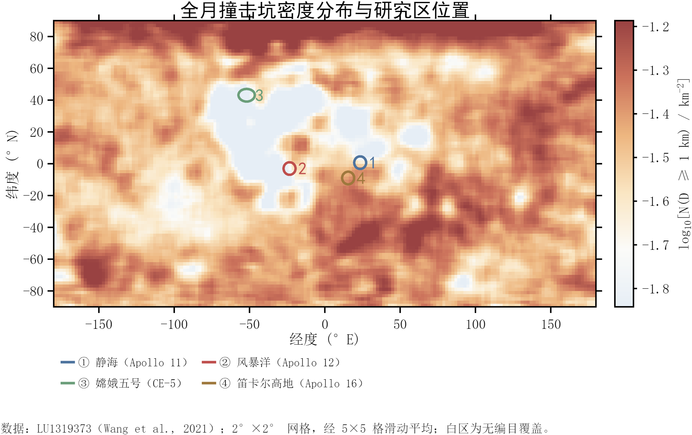
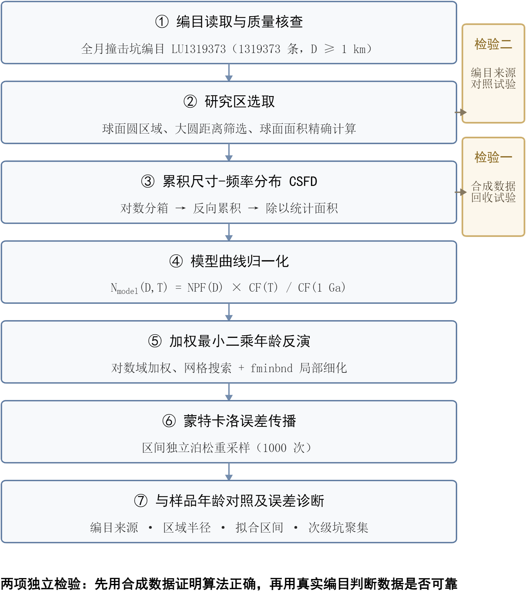
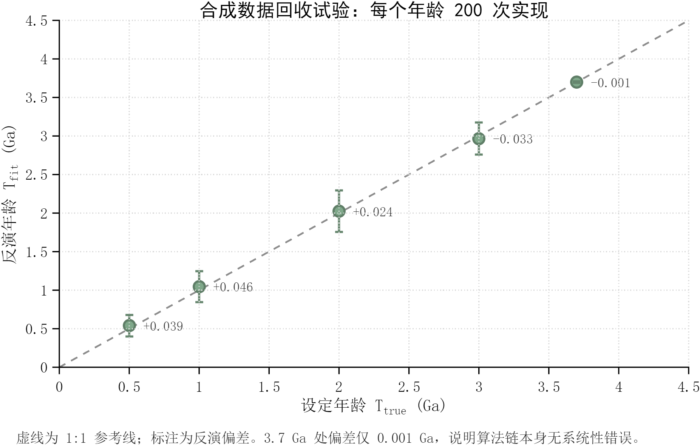
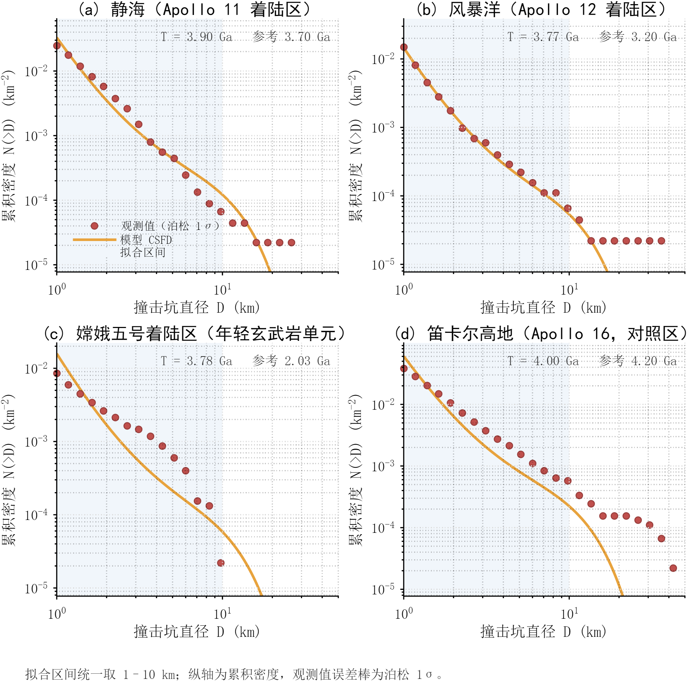
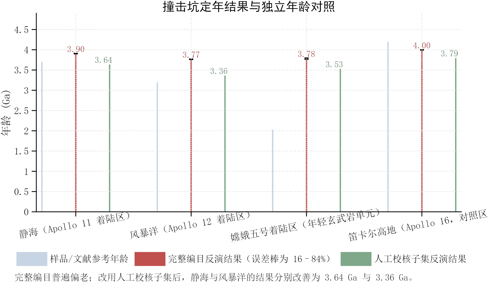
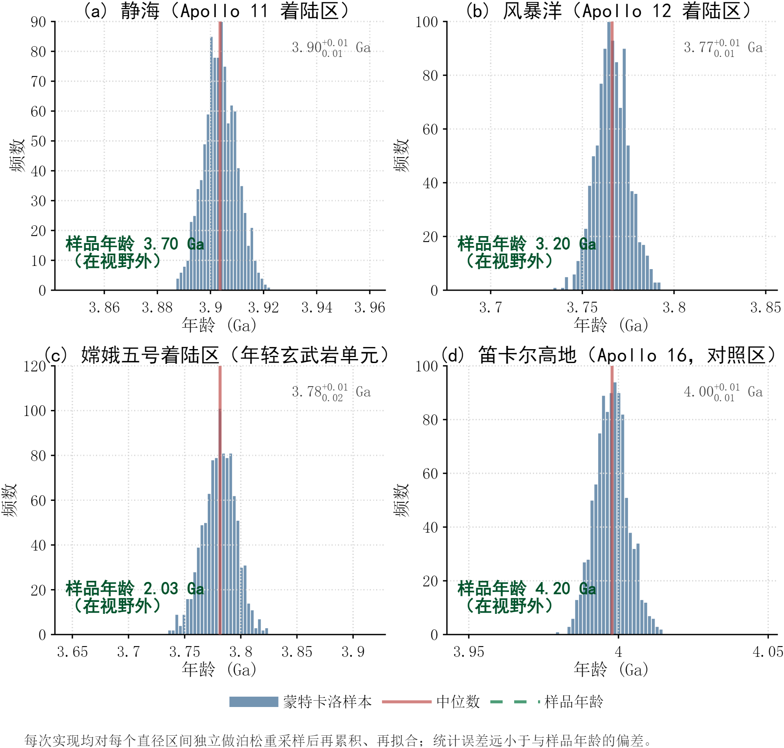
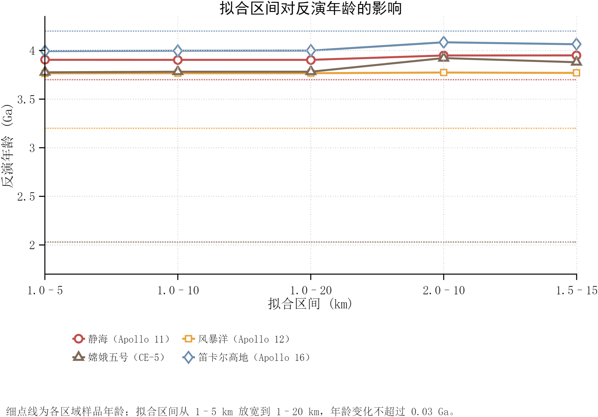

# 🌕 Lunar Crater Chronology
### 基于 MATLAB 的月球撞击坑统计定年与月海年龄估算
**Lunar Surface Age Estimation from Crater Size–Frequency Distributions**

`MATLAB R2025a` · `Planetary Science` · `CSFD` · `Neukum Chronology` · `Monte Carlo`

本项目围绕一个核心科学问题：**如何利用撞击坑统计信息推断月球表面年龄，以及如何判断这些结果是否可靠？**

以全月撞击坑编目为基础，在 MATLAB 中实现从数据读取、研究区选取、累积尺寸—频率分布（CSFD）构建，到年代模型反演、统计检验和科研绘图的一体化流程。研究进一步对比编目来源与拟合参数的影响，将**年龄计算**与**结果可信度分析**结合起来。

This MATLAB research project develops an integrated computational workflow for lunar crater chronology, combining crater catalog processing, CSFD modeling, age estimation, Monte Carlo analysis, and data-source comparisons.

## ✨ Project highlights · 项目亮点

| 数据规模 | 研究区域 | MATLAB 源码 | 不确定性分析 |
| :---: | :---: | :---: | :---: |
| **1,319,373** 条编目记录 | **4** 个典型月表区域 | **26** 个模块化文件 | **1,000** 次蒙特卡洛重采样 |

- **完整计算链**：球面几何选区 → CSFD 构建 → Neukum 年代反演 → 误差分析 → 图表输出。
- **模型自检**：构造已知年龄的合成撞击坑数据，检验反演算法的年龄恢复能力。
- **数据质量研究**：对照完整编目与特定来源子集，观察数据组成如何影响定年结果。
- **结果可解释性**：分析拟合直径区间、区域尺度与年轻地质单元混合问题，识别模型的适用条件。

## 🔬 Study areas · 研究区域

| 研究区 | 科学背景 | 完整编目模式年龄* |
|---|---|---:|
| 静海（Mare Tranquillitatis） | Apollo 11 着陆区 | **3.90 Ga** |
| 风暴洋（Oceanus Procellarum） | Apollo 12 着陆区 | **3.77 Ga** |
| 嫦娥五号着陆区（Chang'e-5） | 年轻月海玄武岩区域 | **3.78 Ga** |
| 笛卡尔高地（Descartes Highlands） | Apollo 16 对照区域 | **4.00 Ga** |

*表中为研究报告采用完整编目与特定模型设置计算的撞击坑统计模式年龄，不是样品同位素定年值。不同区域的模型适用性在项目中进一步讨论。*

## 📈 Key findings · 关键研究发现

**01 · 合成数据验证**

在给定年代模型的合成数据回收实验中，研究报告所列各测试年龄的平均恢复偏差约在 **0.05 Ga 以内**，为算法实现提供了独立于真实编目质量的检查。

**02 · 编目来源影响年龄反演**

筛选特定人工校核来源后，静海与风暴洋的模式年龄分别调整至 **3.64 Ga** 和 **3.36 Ga**，与对应样品参考年龄的差异缩小。这说明数据来源与编目组成是月表定年中值得单独考察的因素。

**03 · 探索方法适用范围**

嫦娥五号年轻玄武岩区域的模型年龄与样品年龄差异显著。项目结合区域尺度、地质单元混合和撞击坑直径下限，分析了为何年轻月表需要更高分辨率编目。

详见 [Research insights / 研究发现与方法思考](docs/RESEARCH_INSIGHTS.md)。

## 🖼️ Figures · 研究图件

以下 8 张图来自项目研究报告，覆盖技术路线、输入数据、算法验证、模型拟合、结果及敏感性分析。点击图片可查看原始分辨率。

| 研究流程 / Workflow | 全球撞击坑密度 / Lunar catalog |
|---|---|
|  |  |
| **合成数据年龄回收 / Synthetic validation** | **四区 CSFD 拟合 / Model fitting** |
|  |  |
| **年龄对照 / Age comparison** | **蒙特卡洛分布 / Monte Carlo** |
|  |  |
| **拟合区间敏感性 / Sensitivity** | **编目来源对照 / Data provenance** |
|  |  |

## 🧠 Methods & engineering · 技术方法

| 模块 | 实现内容 | 代表文件 |
|---|---|---|
| 数据处理 | 读取全月撞击坑编目、字段清洗与单位统一 | `s01_read_catalog.m` |
| 空间分析 | 月固坐标、球面大圆距离与研究区选择 | `s02_regions.m` |
| 统计建模 | 对数分箱、累积尺寸—频率分布（CSFD） | `s03_csfd.m` |
| 年代反演 | Neukum 生产函数 / 年代函数、加权最小二乘拟合 | `s04_model.m`、`s05_fit_age.m` |
| 不确定性量化 | 泊松重采样、蒙特卡洛年龄区间 | `s06_montecarlo.m` |
| 科学检验 | 合成数据回收、参数敏感性及来源对照 | `s07_selftest.m`、`diagnose_sources.m` |
| 可视化 | 密度图、CSFD、对照图与论文图件导出 | `make_paper_figures.m` |

## 🗂️ Repository structure · 目录结构

    lunar-crater-chronology/
    ├── README.md                  # 项目介绍与结果展示
    ├── assets/                    # 8 张研究结果图（PNG）
    ├── code/                      # 26 个 MATLAB 源文件
    │   ├── config.m              # 区域、路径及参数配置
    │   ├── run_all.m             # 完整分析入口
    │   ├── analyze_crater_age.m  # 单区域分析接口
    │   ├── test_synthetic.m      # 合成数据测试
    │   └── ...                   # 数据、建模、诊断与可视化模块
    ├── data/                      # 原始编目放置说明
    └── docs/                      # 研究发现与方法思考

## 🚀 Getting started · 运行指南

**Environment:** MATLAB R2025a（项目使用 MATLAB 内置函数，无额外工具箱需求）。

**1. 准备撞击坑编目**

参考 [数据来源与准备说明](data/README.md) 获取原始 **LU1319373** 全月撞击坑编目，并放入以下路径：

    data/raw/LU1319373/LU1319373_Wang & Wu_2021.txt

如本地路径不同，在 `code/config.m` 中调整 `cfg.rawCatalog`。

**2. 运行完整流程**

在 MATLAB 中将工作目录设为仓库根目录，执行：

    run('code/run_all.m')

**3. 运行合成数据测试**

无需下载完整编目，也可以通过合成输入探索 CSFD → 年龄拟合 → 不确定性分析的主要计算过程：

    run('code/test_synthetic.m')

运行过程会按配置生成结果缓存、表格和绘图文件。报告附录中的 MATLAB 源码已整理到 `code/`，适合进一步阅读、复核与扩展。

## 🌌 Why this project? · 项目价值

这项工作将**行星科学问题、数值计算、数据质量评估和可视化表达**结合在一起。它不仅关注得到一个年龄数值，更关注这个数值如何产生、哪些假设会影响它，以及如何通过数据对照和模型检验提升科学解释的可靠性。

*Undergraduate research portfolio · Planetary science × Scientific computing*

**Author:** [liuyun-jay](https://github.com/liuyun-jay)
